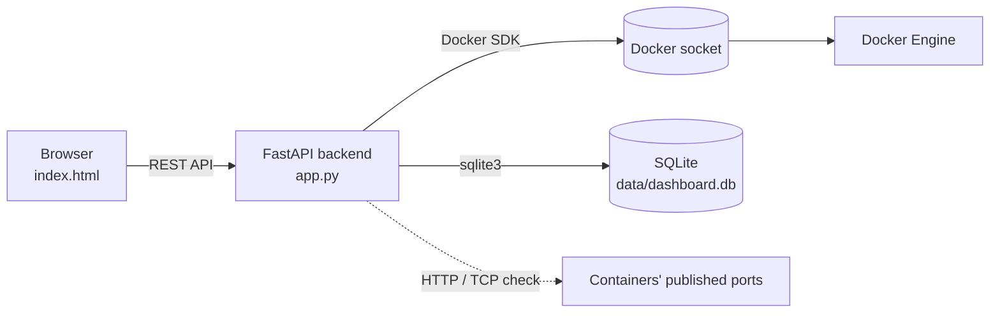

# DockerDash

**A lightweight, self-hosted web dashboard for monitoring and managing Docker containers.**

DockerDash shows every Docker container on a machine in one web page: its status, its address,
whether the app inside is responding, and buttons to control it. It is built with **FastAPI**,
the **Docker SDK for Python**, **SQLite** and a plain **HTML/JavaScript** page.

---

## How It Works (in Simple Words)

1. **Docker runs your apps in containers.** Normally you check on them by typing commands like `docker ps`.
2. **DockerDash shows all of them in a web page instead**, at `http://localhost:9000`.
3. **It asks Docker for the information** through the Docker socket, the same channel the `docker` command uses.
4. **It remembers each app's address** in a small database. You can change it with the *Edit* button.
5. **It checks whether each app is answering** and shows **UP** or **DOWN** with the response time.
6. **You can control containers with buttons:** Start, Stop, Restart, Pause, Logs and Remove.
   The dashboard cannot stop or remove itself.
7. **The page refreshes itself every 10 seconds.**

---

## Features

- List of all containers with name, image, status, health and ports
- Running / stopped / total counts
- Clickable links to each app
- **HTTP checks** for web apps and **TCP checks** for databases and other services
- Saved addresses per container, editable from the page
- Start, Stop, Restart, Pause, Unpause, Remove and Logs
- Self-protection: the dashboard's own container cannot be stopped or removed from the page

---

## Quick Start

**Requirement:** Docker Desktop (Windows / Mac) or Docker Engine (Linux), running.

```bash
docker compose up -d --build
```

Open **http://localhost:9000**. To stop it:

```bash
docker compose down
```

---

## Project Structure

```
dockerdash/
├── app.py               # Backend: talks to Docker, runs health checks, serves the API
├── db.py                # Database functions (saved addresses)
├── schema.sql           # Database tables
├── static/index.html    # Frontend: the dashboard page
├── Dockerfile           # Builds the dashboard image
└── docker-compose.yml   # Runs it: port 9000, Docker socket, data folder
```

---

## How It Works (Technical)



### The Docker socket

Docker has two parts: the **Docker Engine**, which actually runs containers, and the **`docker`
command**, which only sends requests to the Engine. They talk through a **socket**, a
communication channel between programs on the same machine, located at `/var/run/docker.sock`.

DockerDash runs inside a container, so `docker-compose.yml` mounts this socket into it:

```yaml
volumes:
  - /var/run/docker.sock:/var/run/docker.sock
```

`app.py` then connects with `docker.from_env()` and can list and control containers, just like the
`docker` command.

### Health checks

- Each running container is checked at its **first saved address**. If none is saved, its first
  published port is used.
- **HTTP check:** UP if the app returns any status below 500.
- **TCP check:** UP if the port accepts a connection (useful for databases, e.g. `tcp:localhost:5432`).
- All checks run **in parallel** with `asyncio`, so one slow app does not slow down the page.
- Inside a container, `localhost` means the container itself, so the dashboard replaces it with
  **`host.docker.internal`** to reach the host's ports. On Linux this is enabled by the
  `extra_hosts` entry in `docker-compose.yml`.

### Saved addresses (database)

- The first time a running container is seen, its published ports are saved automatically.
- After that it is never auto-saved again, so changes made with *Edit* are kept.
- Addresses are stored by **container name**, in two tables: `saved_urls` and `seen_containers`.

### Self-protection

Stopping, pausing or removing the dashboard from its own page would shut the page down, with no
way to start it again from there. So these actions are blocked for the dashboard's own container
(API returns `403`) and its buttons are greyed out. Use `docker compose down` to stop it.

---

## API Endpoints

| Method | Endpoint | Description |
|---|---|---|
| `GET` | `/api/containers` | All containers with status and health check results |
| `POST` | `/api/containers/{id}/{action}` | `start`, `stop`, `restart`, `pause`, `unpause` or `remove` |
| `GET` | `/api/containers/{id}/logs` | Recent logs of a container |
| `GET` | `/api/urls` | All saved addresses |
| `POST` | `/api/urls` | Save an address: `{ "container": "name", "url": "localhost:8080" }` |
| `DELETE` | `/api/urls/{name}` | Clear a container's saved addresses |
| `GET` | `/api/info` | Docker version |

Interactive API documentation is available at **http://localhost:9000/docs**.

---

## Configuration

Set in `docker-compose.yml`:

| Variable | Default | Description |
|---|---|---|
| `DASH_PORT` | `9000` | Port of the dashboard |
| `DASH_PING_TIMEOUT` | `3` | Health check timeout (seconds) |
| `DASH_SELF_NAME` | `dockerdash` | Dashboard's own container name (must match `container_name`) |
| `DASH_DB` | `/data/dashboard.db` | Database file location |

---

## Security Note

Access to the Docker socket gives **full control of Docker** on the machine, and the dashboard has
**no login**. Run it only on your own machine and do not expose port 9000 to the internet. To allow
access only from the same computer, use `"127.0.0.1:9000:9000"` in `docker-compose.yml`.

---

## Troubleshooting

| Problem | Solution |
|---|---|
| `port is already allocated` | Port 9000 is in use. Change it, e.g. `"9100:9000"` |
| *"Could not load"* on the page | Make sure Docker Desktop is running |
| An app shows DOWN but opens in the browser | Its saved address may be outdated. Click *Edit* and enter the correct one |
| A database shows DOWN | It does not answer HTTP. Click *Edit* and enter `tcp:localhost:<port>` |
